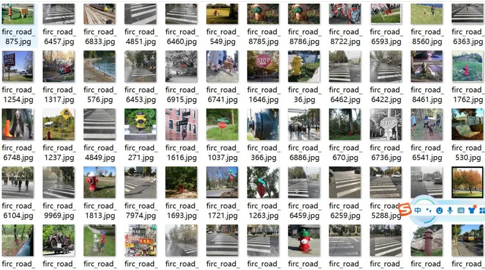
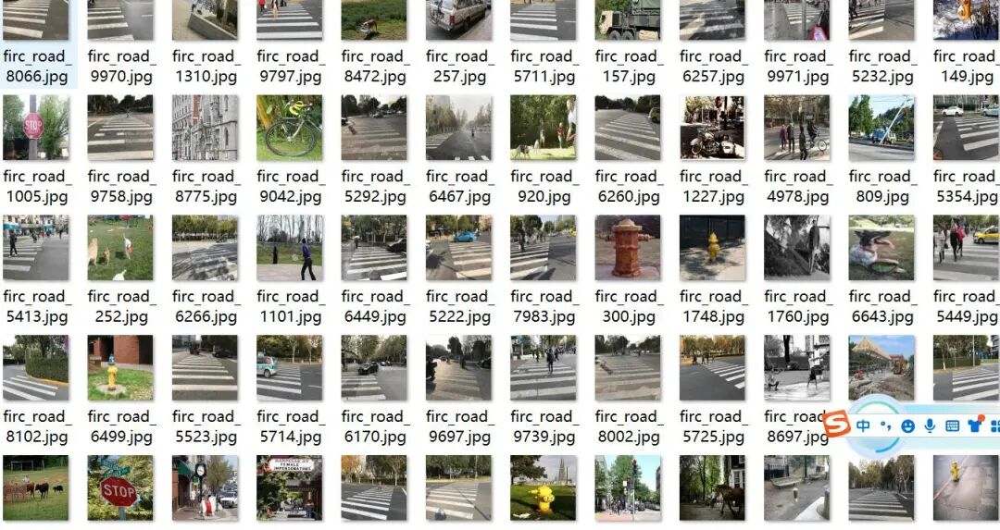
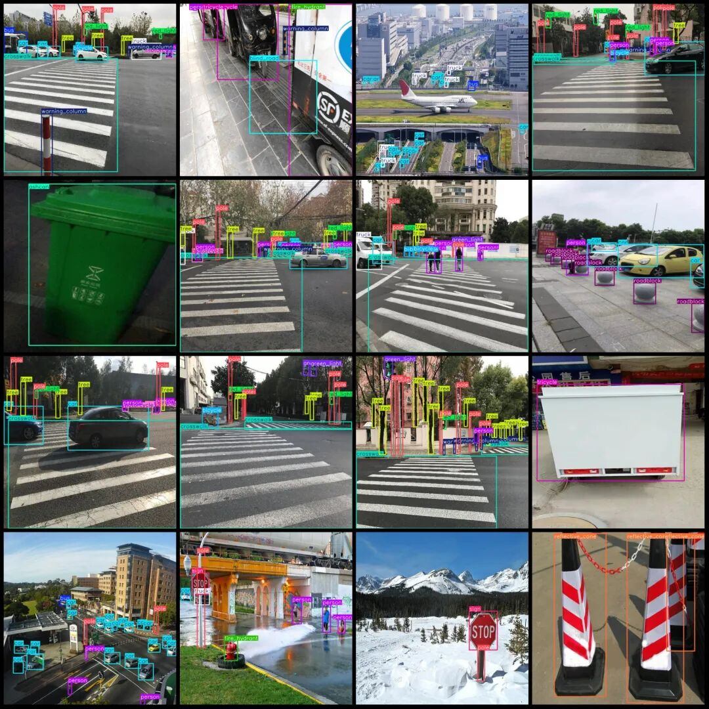

# Visually Impaired Persons' Assistive Mobility Data Set Road Obstacle Trash Can Pedestrian Crossing Blind Path Tricycle Detection Dataset VOC+YOLO Format 9977 Images 20 Categories

Dataset format: Pascal VOC format + YOLO format (txt file without split path, only containing jpg images and corresponding VOC format xml files and yolo format txt files)

Number of images (number of jpg files): 9977

Number of annotations (number of xml files): 9977

Number of annotations (number of txt files): 9977

Label category count: 20

Label category names (Note that the order of labels in the YOLO format does not correspond to this, but is based on the classes.txt file in the labels folder): ["ashcan", "bicycle", "blind_road", "bus", "car", "crosswalk", "dog", "fire_hydrant", "green_light", "motorcycle", "person", "pole", "red_light", "reflective_cone", "roadblock", "sign", "tree", "tricycle", "truck", "warning_column"]

Number of boxes labeled in each category:

Ashcan (trash can) frame count = 2064

Bicycle (bike) Frame Count = 4368

Blind Road (Blind Path) Frame Count = 1674

Bus (bus) Frames = 1257

car (sedan) frame count = 19669

Crosswalk (pedestrian crossing) frame count = 6132

Number of frames = 710

Fire hydrant (fire hydrant) frame count = 1004

Green_light (green light) Frames = 3551

Motorcycle (Motorcycle) Frame Count = 8777

Person (pedestrian) box count = 24993

Pole (Bar) Frame Count = 22242

Red light (red light) frame count = 3508

reflective_cone (reflective cone) frame count = 2915

Number of roadblock (roadblock) frames = 3192

Sign (signboard) frame count = 2333

Tree (Tree) Frames = 16322

Tricycle (three-wheeled cart) frame count = 1139

Truck (truck) Frame Count = 2533

warning_column (warning column) box count = 7513

Total frame count: 135896

Image resolution: 640x640

Using labelImg:

Annotation rules: Draw a rectangle around the category.

Important Notice: No

Special : This dataset does not guarantee the accuracy of the trained models or weight files.

Image Preview:

Annotation example:

## Payment

Here is a pay link on Stripe ( https://buy.stripe.com/3cs8yP7sY87d0vu9AB ). Please contact me lonlonago@foxmail.com after funding $89, and I will send you a complete data files , thank you!

